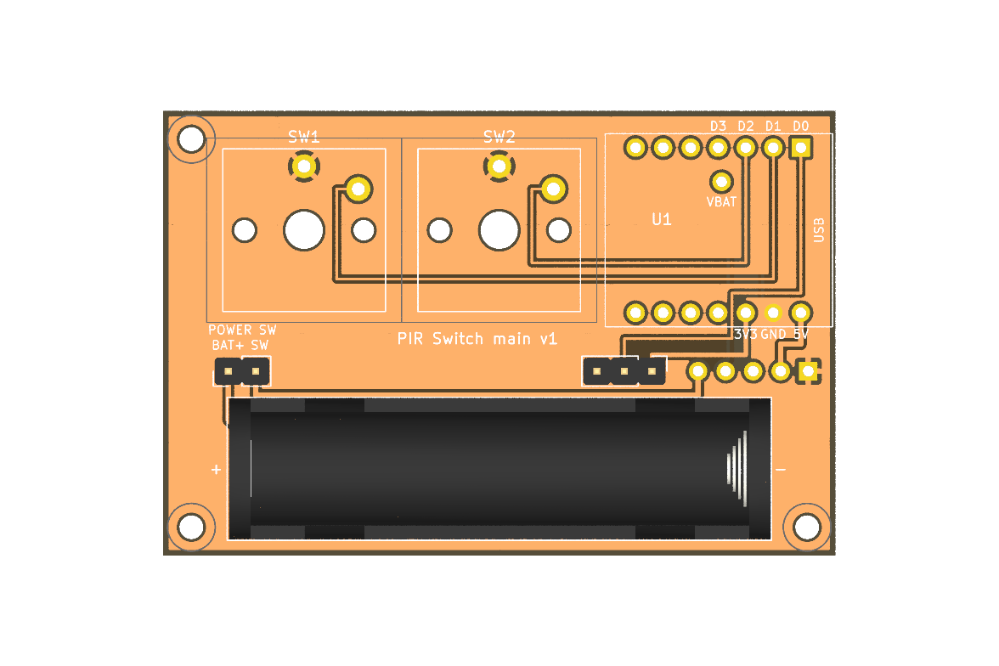
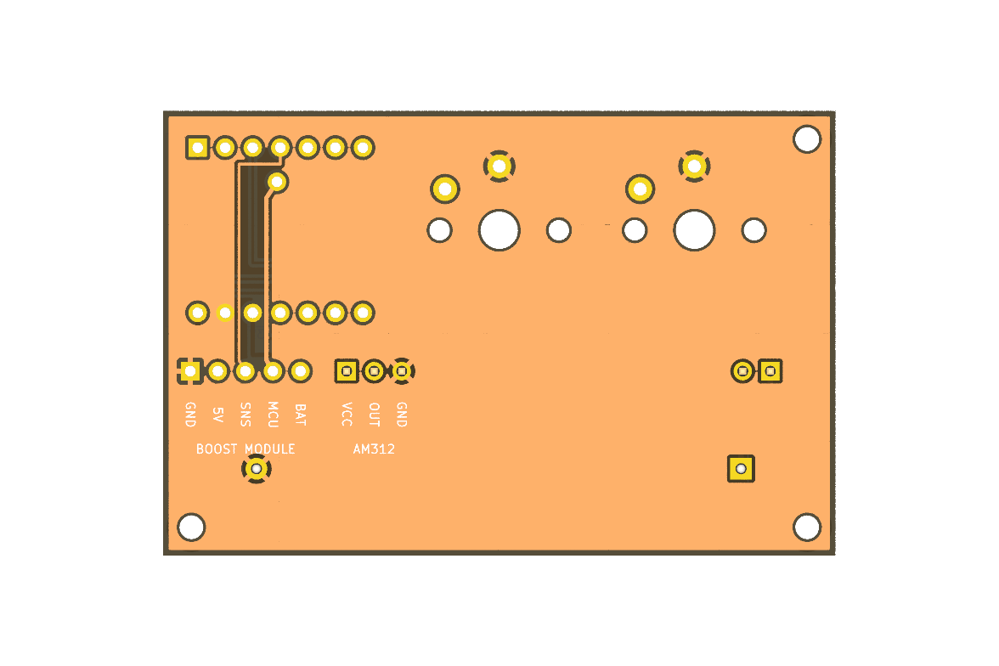

# PIR Switch メイン基板 v1

XIAO nRF52840・Choc スイッチ2個・単4電池ホルダーを載せ、昇圧モジュール（aaa-boost-module-v2）と AM312 を差し込むメイン基板です。

- 基板サイズ：**62 × 41mm**、2層（両面 GND ベタ）
- 部品はすべて挿入部品（はんだごてで組み立て可能）
- ERC（回路図）・DRC（基板）・回路図と基板の一致チェック：すべて 0 件（KiCad 9.0.3）

| 表面 | 裏面 |
|---|---|
|  |  |

## 部品

| 番号 | 部品 | 備考 |
|---|---|---|
| U1 | Seeed XIAO nRF52840 | ピンヘッダ（1×7 を2本）で実装。USB 端子は基板の右端 |
| SW1 | Kailh Choc V1（PG1350） | スイッチA（モード1）。基板に直接はんだ付け |
| SW2 | Kailh Choc V1（PG1350） | スイッチB（モード2） |
| BT1 | Keystone 2466（単4 1本用ホルダー） | 左が＋、右が− |
| J1 | 1×3 ピンヘッダ（2.54mm） | AM312 を電線でつなぐ（VCC / OUT / GND） |
| J2 | 1×5 ピンヘッダ（2.54mm） | 昇圧モジュールを差す（1 GND, 2 5V, 3 SNS, 4 MCU, 5 BAT）。角パッド = 1番（右端） |
| J3 | 1×2 ピンヘッダ（2.54mm） | 電源スイッチを電線でつなぐ（BAT+ / SW） |
| H1〜H3 | M2 取付穴 | 右上は XIAO があるため穴なし |

## 回路

| ネット | つながる先 |
|---|---|
| D0_PIR | XIAO D0 ― J1 OUT |
| D1_SW_A | XIAO D1 ― SW1 |
| D2_SW_B | XIAO D2 ― SW2 |
| BAT_SNS | XIAO D3 ― J2 SNS |
| +3V3 | XIAO 3V3 ― J1 VCC |
| VBUS | XIAO 5V ― J2 5V |
| VBAT | XIAO 裏面の VBAT パッド（U1 の 15 番の穴）― J2 MCU |
| BAT_SW | J2 BAT ― J3 SW |
| BAT_P | J3 BAT+ ― 電池＋ |
| GND | XIAO GND、SW1・SW2、J1 GND、J2 GND、電池− |

ファームウェア（`config/boards/shields/pir_switch/`）の配線と同じです。

## 組み立ての注意

1. **XIAO の VBAT を先に配線する**：XIAO 裏面の VBAT パッドに細い電線（またはピン）をはんだ付けし、メイン基板の「VBAT」の穴に通してから XIAO をピンヘッダに載せる。XIAO を付けた後では VBAT パッドに手が届きません。
2. **昇圧モジュールの向き**：J2 の角パッド（右端）が 1番（GND）。モジュールの 1番（角パッド）と合わせて、基板に垂直に立てて差す。
3. **電源スイッチ**：J3 の BAT+ と SW の間を ON/OFF するスイッチを、ケースに付けて電線でつなぐ。
4. **AM312**：J1 に電線でつなぐ。AM312 の VCC / OUT / GND の並びは製品によって違うので、AM312 側の表示で確認すること。

## 未確認のこと（試作前に確認してください）

- **XIAO の VBAT パッドの位置**：Seeed 公式の KiCad フットプリント（XIAO-nRF52840-SMD）から換算した位置です。実物と照らし合わせてください（電線でつなぐので多少ずれても問題ありません）。
- **Choc スイッチの穴寸法**：keyswitch-kicad-library の Kailh Choc V1 と同じ寸法で作りました。実物のスイッチで穴に合うか確認してください。
- **電池ホルダーとエネループの相性**：Keystone 2466 の寸法は KiCad 標準ライブラリのものです。
- **高さ**：昇圧モジュールを垂直に立てると基板から約13mm、Choc スイッチ＋キーキャップは約8mm になります。ケースの設計で考慮してください。

## ファイル

| ファイル | 内容 |
|---|---|
| `pir_switch_main.kicad_pro` / `.kicad_sch` / `.kicad_pcb` | KiCad 9 プロジェクト |
| `pir_switch.pretty/` | 専用フットプリント（XIAO、Choc V1、昇圧モジュール用 5 ピン端子） |
| `pir_switch.kicad_sym` | 専用シンボル（XIAO nRF52840） |
| `pir_switch_main_schematic.pdf` | 回路図の PDF |
| `production/pir_switch_main_gerbers.zip` | 基板メーカーに送る製造データ（ガーバー＋ドリル） |
| `production/bom.csv` | 部品表 |
